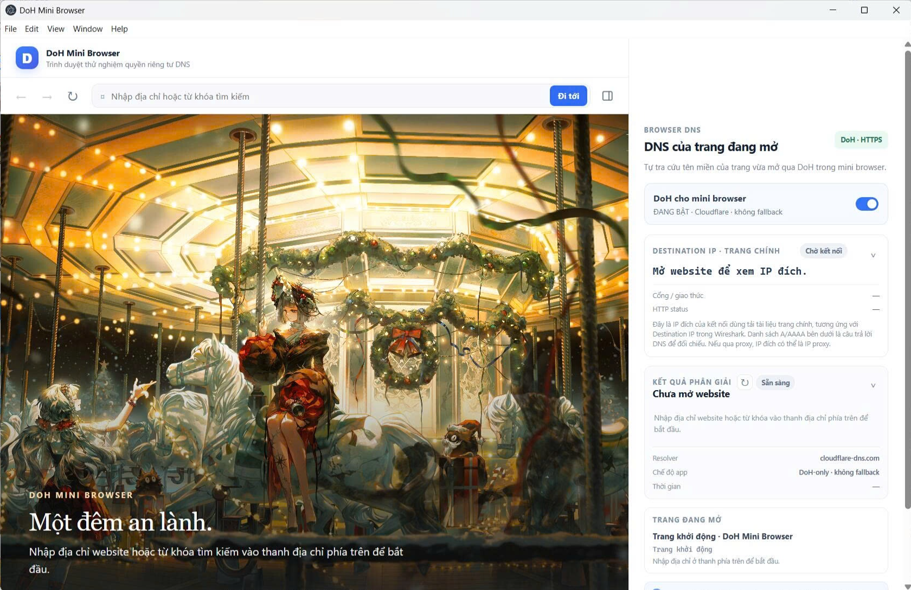
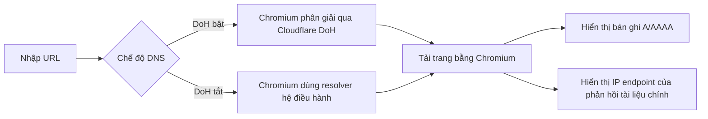

## Thành viên và phân công

| Thành viên | Phần phụ trách |
|---|---|
| **Ngô Đồng Quang Nguyên — Nhóm trưởng** | Khởi tạo repository; phụ trách nền tảng Electron, cấu hình cửa sổ, điều hướng và chế độ DNS/DoH trong `electron/main.js`; cầu nối giữa giao diện và tiến trình chính trong `electron/preload.js`. |
| **Lương Phạm Xuân Bảo** | Phụ trách giao diện và tương tác mini browser trong `src/index.html`, `src/app.js`, `src/style.css`; hiển thị thông tin DNS và kết nối. |
| **Lê Nguyễn Khôi Nguyên** | Phụ trách trang khởi động và hình minh họa trong `src/start.html`, `src/start.css`, `src/assets/`; tài liệu dự án và hướng dẫn cài đặt. |

# DoH Mini Browser

Ứng dụng desktop thử nghiệm cho môn Lập trình mạng. Mini browser có công tắc DoH riêng và tự tra cứu A/AAAA cho hostname của trang đang mở bằng chính resolver cấu hình cho Chromium.

## Giao diện



> **Phạm vi trạng thái:** công tắc cho biết cấu hình DNS mà mini browser tự đặt, không phát hiện trạng thái DoH toàn hệ thống, app 1.1.1.1 hoặc WARP. Khi bật, app đặt Chromium ở chế độ `secure` với resolver Cloudflare và không cho fallback sang DNS thường. Khi tắt, resolver Chromium gửi DNS theo máy chủ DNS hệ điều hành cấu hình. VPN/WARP vẫn có thể bọc lưu lượng đó. Các ứng dụng khác trên máy không bị thay đổi.

## Yêu cầu

- Windows 10/11 64-bit là môi trường được hướng dẫn cài đặt trong dự án. macOS/Linux chưa được nhóm xác nhận.
- Node.js LTS và npm. Trên Windows, nhóm khuyến nghị Node.js 24 LTS.
- Kết nối Internet để tải Electron và gửi truy vấn tới Cloudflare DNS.

`package.json` ghim `yauzl` phiên bản mới hơn thông qua `overrides` để tránh lỗi giải nén Electron đã được báo cáo với Node.js 26 trên Windows.

## Cài đặt

Hướng dẫn từng bước dành cho các bạn trong lớp nằm tại [HUONG_DAN_CAI_DAT.md](./HUONG_DAN_CAI_DAT.md). Tóm tắt lệnh chạy từ thư mục có `package.json`:

```sh
npm ci
npm start
```

Nếu npm báo đã bỏ qua script cài đặt Electron, hãy làm theo mục khắc phục lỗi trong hướng dẫn cài đặt để duyệt script Electron rồi chạy `npm rebuild electron`.

## Cách dùng

1. Ứng dụng mở trang khởi động minh họa, không tự kết nối website nào. Nhập URL (ví dụ `https://example.com`) hoặc tên miền vào thanh địa chỉ phía trên rồi nhấn Enter / **Đi tới**. Nhập từ khóa sẽ mở kết quả tìm kiếm DuckDuckGo.
2. Dùng ←, → và ↻ để điều hướng.
3. Công tắc **DoH mini browser** bật/tắt Secure DNS cho browser bên trong app. Khi đổi chế độ, app xóa DNS cache rồi tải lại trang hiện tại.
4. Bảng bên phải tự tra cứu hostname của trang hiện tại qua cùng Chromium resolver. Nút ↻ cạnh kết quả chạy lại tra cứu A và AAAA, bỏ qua cache resolver. Mục **Destination IP · trang chính** hiển thị IP đích mà Chromium kết nối để tải tài liệu chính, cùng cổng, giao thức và HTTP status. Danh sách DNS là câu trả lời A/AAAA để đối chiếu; IP đích thực tế có thể khác hoặc chọn một địa chỉ trong số đó.
5. Hai thẻ **Kết nối trang chính** và **Kết quả phân giải** có thể thu gọn/mở riêng bằng cách nhấn tiêu đề. Nút biểu tượng khung bên phải cạnh thanh địa chỉ thu gọn/mở toàn bộ sidebar; khi thu gọn, vùng trang web rộng ra.
6. Để kiểm chứng trên lớp, bắt lưu lượng bằng Wireshark khi chuyển trang/tải lại. Khi bật DoH, truy vấn browser tới Cloudflare đi trong HTTPS và nội dung DNS không hiện thành gói DNS thường; khi tắt, truy vấn DNS có thể thấy ở filter `dns` / cổng 53. Đóng các ứng dụng mạng khác để giảm nhiễu. Wireshark xác nhận hành vi trên mạng; trạng thái trong app cho biết chế độ resolver mà app đã cấu hình.

## Luồng hoạt động



DoH mã hóa truy vấn DNS giữa mini browser và resolver. Sau khi phân giải, Chromium vẫn kết nối tới website qua HTTP/HTTPS; DoH không thay thế HTTPS và không che IP kết nối khỏi website.

## Các phần trên giao diện

| Khu vực | Nhiệm vụ | Nội dung hiển thị |
| --- | --- | --- |
| Thanh đầu trang | Nhận diện sản phẩm. | Tên ứng dụng và trạng thái mini browser. |
| Thanh điều hướng | Nhập URL/từ khóa và thao tác lịch sử trang. | Nút quay lại, tiến tới, tải lại, ô địa chỉ nằm trên cùng, nút Đi tới và nút ẩn/hiện sidebar. |
| Trang khởi động | Chào người dùng và hiển thị ảnh minh họa được chép trong dự án. | Ảnh Silent Night, Holy Night; không tự truy cập website hay gửi truy vấn DNS. |
| Khung web bên trái | Hiển thị trang khởi động hoặc website đang mở bằng Chromium của Electron. | Nội dung website; app không trích xuất nội dung trang vào bảng DNS. |
| Công tắc “DoH cho mini browser” | Bật/tắt Secure DNS cho browser của app. | Trạng thái BẬT/TẮT, resolver Cloudflare hoặc DNS hệ điều hành. |
| Thẻ “Destination IP · trang chính” | Đọc địa chỉ remote IP từ phản hồi mạng của tài liệu chính qua Chromium DevTools Protocol; bỏ qua HTTP cache và service worker trong mini browser để hạn chế phản hồi không có socket IP mới. | IP đích của kết nối trang chính, cổng, giao thức và HTTP status. Không đại diện cho mọi kết nối CDN/tài nguyên phụ; proxy có thể làm IP hiển thị là endpoint proxy. |
| Bảng “DNS của trang đang mở” | Tra cứu hostname hiện tại bằng resolver mà browser dùng. | Bản ghi A/AAAA, IP trả về, trạng thái, resolver và thời gian. |
| Nút sidebar | Thu gọn/mở bảng thông tin DNS. | Khi ẩn, khung website mở rộng hết chiều ngang. |
| Tiêu đề “Destination IP · trang chính” và “Kết quả phân giải” | Thu gọn/mở nội dung của từng thẻ. | Các tiêu đề khác luôn hiển thị cùng nội dung. |
| Thẻ “Trang đang mở” | Cho biết địa chỉ và trạng thái điều hướng hiện tại. | Tiêu đề trang, URL và trạng thái tải/lỗi. |
| Thẻ thông tin | Nêu rõ phạm vi của công tắc. | Chỉ áp dụng cho mini browser, không kiểm tra Windows/1.1.1.1/WARP. |
| Dòng cuối bảng | Nêu chế độ DNS và xử lý dữ liệu. | DoH-only khi bật; resolver hệ điều hành khi tắt; không lưu lịch sử vào file. |

## Ghi chú từng phần

| File / phần | Nhiệm vụ | Hiển thị hoặc xử lý |
| --- | --- | --- |
| `electron/main.js` | Tạo cửa sổ; cấu hình Secure DNS của Chromium; điều hướng; phân giải hostname trang qua Electron Session; theo dõi phản hồi tài liệu chính qua CDP; đổi kích thước khung khi ẩn/hiện sidebar. | Trạng thái trang, chế độ DNS, A/AAAA, IP endpoint phản hồi, cổng, giao thức và HTTP status. |
| `electron/preload.js` | Cung cấp API IPC giới hạn cho giao diện qua `contextBridge`. | Không có UI; ngăn renderer truy cập trực tiếp API Node/Electron. |
| `src/index.html` | Khai báo cấu trúc giao diện tiếng Việt. | Header, thanh URL, bảng DoH, thông tin trang và chú thích giới hạn. |
| `src/style.css` | Định dạng giao diện và bố cục browser / inspector. | Màu sắc, nút, kết quả, trạng thái và thông báo. |
| `src/start.html`, `src/start.css` | Tạo trang đầu cục bộ để thay cho website mẫu. | Lời chào, hướng dẫn dùng thanh địa chỉ phía trên và bố cục ảnh. |
| `src/assets/silent-night.png` | Bản sao nội bộ của ảnh người dùng đã chọn. | Hiển thị ảnh trên trang khởi động; ứng dụng không tham chiếu thư mục Pictures/OneDrive. |
| `src/app.js` | Bắt thao tác người dùng và cập nhật UI từ IPC. | Điều hướng, lỗi, IP trả về, trạng thái và thời gian. |
| `package.json` | Khai báo Electron và lệnh `npm start`. | Không có UI. |
| `.gitignore` | Loại dependency và file build khỏi Git. | Không có UI. |

## Dữ liệu và quyền riêng tư

- Ứng dụng hiện không ghi lịch sử duyệt web vào file.
- IP endpoint của phản hồi trang chính chỉ được giữ trong bộ nhớ để hiển thị trên sidebar; app không lưu danh sách IP này vào file.
- Khi DoH bật, các truy vấn DNS của mini browser được gửi tới Cloudflare; không nhập tên miền nhạy cảm khi demo công khai.
- Browser lưu dữ liệu phiên Electron cục bộ theo partition riêng. Chưa có nút xóa cache/cookie trong MVP.
- Ứng dụng không chụp packet và không giám sát thiết bị khác. Wireshark là công cụ quan sát ngoài trong môi trường lab có thông báo cho người tham gia.

## Thành viên và đóng góp

| Thành viên | Phần phụ trách |
| --- | --- |
| **Ngô Đồng Quang Nguyên — Nhóm trưởng** | Khởi tạo repository và phần nền tảng Electron; cấu hình cửa sổ, điều hướng, DNS/DoH trong `electron/main.js`; cầu nối giới hạn giữa giao diện và tiến trình chính trong `electron/preload.js`. |
| **Lương Phạm Xuân Bảo** | Giao diện và tương tác mini browser trong `src/index.html`, `src/app.js`, `src/style.css`; hiển thị thông tin DNS và kết nối do tiến trình chính gửi về. |
| **Lê Nguyễn Khôi Nguyên** | Trang khởi động trong `src/start.html`, `src/start.css`, ảnh trong `src/assets/`; tài liệu dự án trong `README.md` và `HUONG_DAN_CAI_DAT.md`. |

Phân công trên mô tả các phần chịu trách nhiệm chính; nhóm cần cập nhật nếu công việc thực tế có thay đổi.

## Cấu trúc

```text
electron/   tiến trình chính Electron và preload
src/        giao diện, trang khởi động, ảnh nội bộ và logic renderer
```

## Giấy phép

Xem nội dung giấy phép được chọn trong file [LICENSE](./LICENSE).
