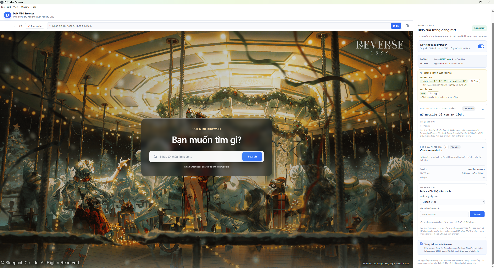
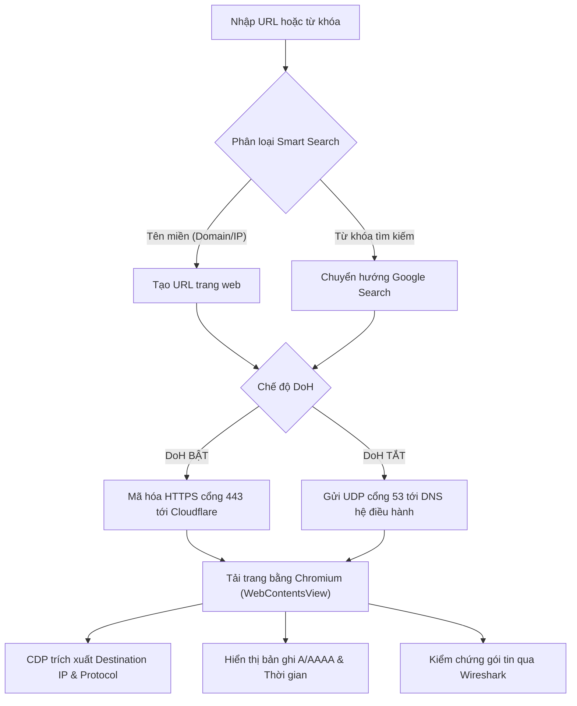

# DoH Mini Browser

Ứng dụng desktop thử nghiệm cho môn Lập trình mạng. Mini browser được tích hợp công tắc DoH riêng, tự động tra cứu bản ghi A/AAAA cho hostname của trang đang mở bằng chính resolver cấu hình cho Chromium, đồng thời hỗ trợ kiểm chứng bằng Wireshark và so sánh với DNS truyền thống qua nhiều nhà cung cấp DoH.

## Giao diện



> **Phạm vi trạng thái:** Công tắc phản ánh cấu hình DNS mà mini browser tự thiết lập cho Chromium trong ứng dụng, không can thiệp hay phát hiện trạng thái DoH toàn hệ điều hành, app 1.1.1.1 hoặc Cloudflare WARP. Khi BẬT, ứng dụng đặt Chromium ở chế độ `secure` với resolver Cloudflare (`https://cloudflare-dns.com/dns-query`) và không fallback sang DNS thường. Khi TẮT, resolver Chromium gửi truy vấn DNS theo cấu hình của hệ điều hành (UDP cổng 53).

## Yêu cầu

- Windows 10/11 64-bit là môi trường được hướng dẫn và kiểm thử chính trong dự án.
- Node.js LTS (khuyến nghị phiên bản 22 LTS hoặc 24 LTS) và npm.
- Kết nối Internet để cài đặt Electron và gửi truy vấn tới Cloudflare DoH / Google / Quad9.
- *(Tùy chọn)* Wireshark để bắt gói tin và đối chiếu cơ chế bảo mật.

## Cài đặt

Hướng dẫn từng bước chi tiết dành cho các bạn trong lớp xem tại [HUONG_DAN_CAI_DAT.md](./HUONG_DAN_CAI_DAT.md). Tóm tắt các lệnh chạy từ thư mục dự án:

```sh
npm ci
npm start
```
*(Trên Windows PowerShell, bạn có thể chạy `npm.cmd start` hoặc `npx.cmd electron .`)*

## Cách dùng

1. **Khởi động và Tìm kiếm:**
   - Ứng dụng mở trang khởi động cục bộ, tích hợp sẵn **ô tìm kiếm Google** ở giữa màn hình.
   - Thanh địa chỉ trên cùng hỗ trợ **Smart Search**: Nhập tên miền (ví dụ: `vnexpress.net`, `example.com`) để mở thẳng website; nhập từ khóa bất kỳ (ví dụ: `thời tiết hôm nay`, `doh là gì`) sẽ tự động chuyển hướng tìm kiếm trên Google.
2. **Điều hướng và Quản lý Cache:**
   - Dùng các nút ←, → và ↻ để quay lại, tiến tới hoặc tải lại trang.
   - Nút **Xóa Cache** trên thanh điều hướng cho phép chủ động xóa sạch host resolver cache của Chromium bất cứ lúc nào để phục vụ đo lường mới.
3. **Chuyển đổi DoH (Hot-toggle):**
   - Công tắc **DoH cho mini browser** cho phép bật/tắt Secure DNS cho browser bên trong app.
   - Khi đổi chế độ, app tự động xóa cache resolver của Chromium (`clearHostResolverCache()`) rồi tải lại trang để ép thực hiện phân giải mới.
4. **Sơ đồ luồng & Hướng dẫn kiểm chứng Wireshark:**
   - Ngay dưới công tắc có sơ đồ luồng gói tin trực quan:
     - **BẬT DoH:** `App → [HTTPS :443 🔒] → Cloudflare`
     - **TẮT DoH:** `App → [UDP :53 ⚠️] → DNS Server`
   - Khung **Kiểm chứng Wireshark** cung cấp sẵn cú pháp bộ lọc kèm nút **Sao chép (Copy)** một chạm:
     - Khi BẬT DoH: `ip.dst == 1.1.1.1 && tcp.port == 443` (dữ liệu DNS nằm trong TLS Application Data, giấu tên miền).
     - Khi TẮT DoH: `dns` (gói tin DNS gửi qua UDP 53 lộ rõ tên miền dạng plaintext).
5. **Thông tin kết nối & Phân giải DNS:**
   - **Destination IP · trang chính:** Hiển thị IP máy chủ web đích mà Chromium thực sự kết nối để tải tài liệu chính, kèm cổng, giao thức (HTTP/2, HTTP/3) và HTTP status từ Chrome DevTools Protocol.
   - **Kết quả phân giải:** Tự động tra cứu các bản ghi A (IPv4) và AAAA (IPv6) của tên miền bằng cùng resolver mà browser đang dùng, kèm thời gian phân giải (`elapsedMs`).
6. **So sánh DNS độc lập đa nhà cung cấp:**
   - Ở thẻ **So sánh DNS**, người dùng có thể chọn nhà cung cấp DoH từ menu dropdown: **Cloudflare DoH**, **Google DNS DoH** hoặc **Quad9 DoH**.
   - Truy vấn DoH được đóng gói theo định dạng nhị phân chuẩn **DoH RFC 8484** (`application/dns-message`) gửi qua HTTPS (cổng 443).
   - Truy vấn đối chứng hệ điều hành sử dụng `dns.resolve4/6` gửi qua UDP cổng 53 thực tế ra ngoài mạng.
   - Hiển thị kết quả IP và thời gian phản hồi (ms) để đối chiếu trực tiếp hiệu năng giữa DoH và DNS truyền thống.

## Luồng hoạt động



## Các phần trên giao diện

| Khu vực | Nhiệm vụ | Nội dung hiển thị |
| --- | --- | --- |
| Thanh đầu trang | Nhận diện sản phẩm | Tên ứng dụng và nhãn trạng thái Mini browser. |
| Thanh điều hướng | Điều hướng, tìm kiếm và quản lý cache | Nút quay lại, tiến tới, tải lại, ô Smart Search, **nút Xóa Cache** và nút ẩn/hiện sidebar. |
| Trang khởi động | Chào mừng và tìm kiếm nhanh | Ảnh minh họa Silent Night và **thanh tìm kiếm Google** trực quan. |
| Khung web bên trái | Hiển thị nội dung website | Giao diện trang khởi động hoặc website HTTP/HTTPS mở qua `WebContentsView`. |
| Công tắc DoH | Bật/tắt Secure DNS | Trạng thái BẬT/TẮT, resolver sử dụng và mô tả giao thức/cổng. |
| Sơ đồ luồng gói tin | Trực quan hóa đường truyền | Minh họa luồng dữ liệu (HTTPS :443 🔒 so với UDP :53 ⚠️). |
| Khung gợi ý Wireshark | Hướng dẫn kiểm chứng | Bộ lọc gợi ý cho Wireshark kèm **nút Sao chép (Copy)** tiện lợi. |
| Thẻ Destination IP | Lấy thông tin socket thực tế | IP đích của tài liệu chính, cổng, giao thức (HTTP/2, HTTP/3) và HTTP status từ CDP. |
| Thẻ Kết quả phân giải | Tra cứu DNS trang hiện tại | Danh sách bản ghi A/AAAA, resolver và thời gian phản hồi (ms). |
| Thẻ So sánh DNS | Đối chiếu đa nhà cung cấp DoH | **Dropdown chọn Cloudflare / Google DNS / Quad9** (chuẩn RFC 8484) và DNS hệ điều hành (UDP thực). |
| Thông tin phạm vi | Ghi chú kỹ thuật | Làm rõ phạm vi cục bộ của ứng dụng, không can thiệp cài đặt mạng Windows. |

## Ghi chú từng phần

| File / phần | Nhiệm vụ | Chi tiết kỹ thuật |
| --- | --- | --- |
| `electron/main.js` | Quản lý tiến trình chính Electron | Cấu hình cửa sổ, nạp `WebContentsView`, cấu hình `configureHostResolver`, phân loại Smart Search (Google), trích xuất IP qua CDP, tra cứu A/AAAA, IPC xóa cache, và triển khai DoH RFC 8484 nhị phân đa resolver (Cloudflare, Google, Quad9). |
| `electron/preload.js` | Cầu nối an toàn IPC | Cung cấp API `window.miniBrowser` giới hạn qua `contextBridge` (bao gồm `clearCache`, `compareDns`), ngăn renderer truy cập trực tiếp Node.js. |
| `src/index.html` | Cấu trúc giao diện | Khung điều hướng, nút Xóa Cache, thanh tra Inspector với sơ đồ luồng, khung Wireshark với nút Copy và dropdown chọn DoH resolver. |
| `src/app.js` | Logic phía renderer | Bắt sự kiện người dùng, tương tác nút Xóa Cache, sao chép Wireshark filter, gửi/nhận dữ liệu IPC, render kết nối và bảng so sánh DNS. |
| `src/style.css` | Định dạng giao diện | Phong cách hiện đại, responsive, thẻ trạng thái, sơ đồ luồng, nút Xóa Cache và nút Copy tiện ích. |
| `src/start.html`, `src/start.css` | Trang khởi động | Ảnh nền minh họa, thông điệp chào mừng và form tìm kiếm Google tích hợp. |
| `src/assets/silent-night.png` | Ảnh minh họa | Hình nền trang khởi động (Reverse: 1999). |
| `screenshots/doh-mini-browser.png` | Ảnh chụp giao diện | Minh họa giao diện thực tế của ứng dụng. |
| `HUONG_DAN_CAI_DAT.md` | Tài liệu cài đặt | Hướng dẫn chi tiết môi trường và cách khởi chạy trên Windows. |

## Dữ liệu và quyền riêng tư

- Ứng dụng không lưu lịch sử duyệt web hay danh sách IP vào tệp ngoài.
- Dữ liệu kết nối và bản ghi DNS chỉ được lưu tạm thời trong bộ nhớ phiên làm việc.
- Khi bật DoH, truy vấn DNS gửi tới Cloudflare qua kênh mã hóa HTTPS; ứng dụng không capture gói tin của các phần mềm khác trên máy.
- Wireshark là công cụ giám sát độc lập bên ngoài dùng trong môi trường thực nghiệm.

## Thành viên và đóng góp

| Thành viên | Phần phụ trách |
|---|---|
| **Ngô Đồng Quang Nguyên — Nhóm trưởng** | Khởi tạo repository và nền tảng Electron; cấu hình cửa sổ, điều hướng và chế độ DNS/DoH trong `electron/main.js`; cầu nối IPC trong `electron/preload.js`; cải tiến độ chính xác đo lường mạng (`dns.resolve4/6` gửi truy vấn UDP thực thay vì đọc cache cục bộ); tái cấu trúc thanh tra Inspector (bổ sung sơ đồ luồng gói tin, bộ lọc kiểm chứng Wireshark, lược bỏ các thẻ thừa và sửa lỗi chặn điều hướng); hoàn thiện tài liệu dự án và hướng dẫn cài đặt. |
| **Lê Nguyễn Khôi Nguyên** | Phụ trách tính năng **Nhận diện thông minh (Smart Search)** trong `electron/main.js` (phân biệt tên miền và tự động tìm kiếm Google khi nhập từ khóa); nâng cấp chức năng **So sánh DNS đa nhà cung cấp** (hỗ trợ lựa chọn Cloudflare DoH, Google DNS, Quad9) sử dụng định dạng gói tin nhị phân chuẩn **DoH RFC 8484** (`application/dns-message`); hỗ trợ tài liệu dự án. |
| **Lương Phạm Xuân Bảo** | Phụ trách giao diện và tương tác mini browser trong `src/index.html`, `src/app.js`, `src/style.css`; thiết kế và tích hợp **thanh tìm kiếm Google trực quan trên trang khởi động** (`src/start.html`, `src/start.css`); bổ sung **nút Xóa Cache nhanh** trên toolbar và **nút Sao chép (Copy) bộ lọc Wireshark tiện lợi**. |

## Giấy phép

Xem nội dung giấy phép trong file [LICENSE](./LICENSE).
